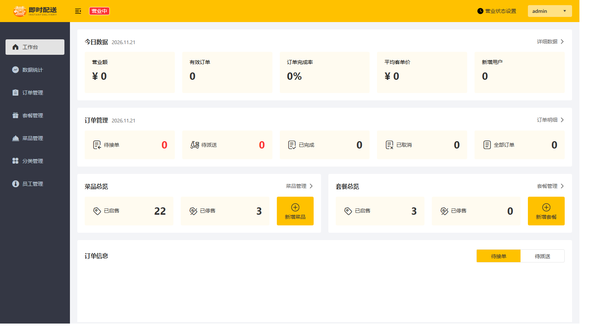
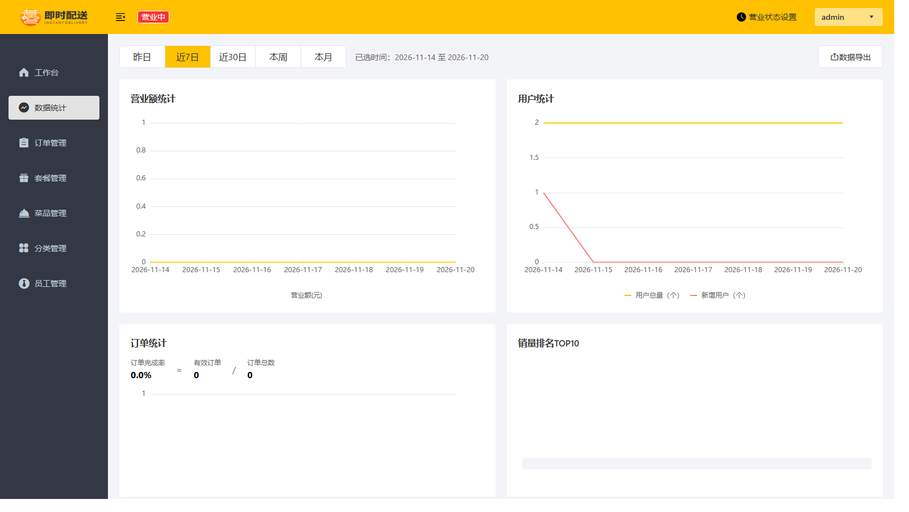

# 苍穹外卖（sky-take-out）

一个前后端分离的外卖点餐系统，包含**管理端**（商家后台）和**用户端**（微信小程序）两套界面，后端为 Spring Boot 单体应用。
本项目基于黑马程序员《苍穹外卖》课程资料整理，保留了完整的后端代码、数据库脚本和前端产物，克隆后按下面的步骤即可在本地跑起来。

<div align="center">
  
  <p>管理端</p>
  
  <p>用户端</p>
</div>

## 技术栈

| 层次 | 技术 |
| --- | --- |
| 前端 | Vue + ElementUI（管理端）、微信小程序（用户端）、Nginx 部署与反向代理 |
| 后端 | Spring Boot 2.7、Spring MVC、MyBatis、PageHelper、Knife4j |
| 数据 | MySQL 8、Redis、Druid 连接池 |
| 其他 | JWT 登录鉴权、阿里云 OSS 文件存储、微信登录与微信支付、POI 报表导出、WebSocket 来单提醒、Spring Task 定时任务 |

## 目录结构

```
sky-take-out-learning/
├── sky-common/                 公共模块：工具类、常量、异常、统一返回结果
├── sky-pojo/                   实体类：entity / dto / vo
├── sky-server/                 业务模块：controller / service / mapper / config / task / websocket
│   └── src/main/resources/
│       ├── application.yml         主配置（端口 8080，默认 dev 环境）
│       ├── application-example.yml 配置模板（复制为 application-dev.yml 后修改）
│       ├── mapper/                 MyBatis 映射文件
│       └── template/               运营数据报表 Excel 模板
├── database/
│   └── sky_take_out.sql        建库建表 + 演示数据（管理员 admin / 123456）
├── frontend/
│   ├── admin/                  管理端打包产物（Vue 编译后的静态文件）
│   ├── nginx.conf              管理端 Nginx 配置示例（监听 8081）
│   └── miniprogram/            用户端微信小程序源码
├── image/                      README 截图
└── pom.xml                     Maven 父工程，聚合三个模块
```

## 功能清单

**管理端**

| 模块 | 说明 |
| --- | --- |
| 登录/退出 | 员工账号登录后才能访问后台 |
| 员工管理 | 查询、新增、编辑、启用/禁用 |
| 分类管理 | 菜品分类、套餐分类的增删改查 |
| 菜品管理 | 增删改查、起售/停售、口味维护、图片上传 |
| 套餐管理 | 增删改查、起售/停售、套餐菜品关联 |
| 订单管理 | 查询、接单、拒单、派送、完成、取消 |
| 数据统计 | 营业额、用户数、订单统计、销量 Top10、Excel 导出 |
| 工作台 | 今日数据、订单概览、菜品/套餐概览 |

**用户端（小程序）**

| 模块 | 说明 |
| --- | --- |
| 登录 | 微信授权登录 |
| 点餐 | 分类浏览、菜品/套餐详情、规格选择 |
| 购物车 | 加购、减购、清空 |
| 下单支付 | 提交订单、微信支付、支付成功页 |
| 订单 | 历史订单、订单详情、取消、再来一单 |
| 个人中心 | 收货地址管理、退出登录 |

## 环境要求

- JDK 8 或 11（Spring Boot 2.7，不建议用 17+）
- Maven 3.6+
- MySQL 8.0
- Redis 5.0+（店铺营业状态、菜品缓存会用到）
- Nginx 1.20+（Windows 版即可，只用于托管管理端静态页面）

## 快速开始

### 1. 初始化数据库

用 Navicat 导入，或者命令行执行：

```bash
mysql -uroot -p < database/sky_take_out.sql
```

脚本会创建 `sky_take_out` 库、11 张表，并写入员工、分类、菜品、套餐等演示数据；
用户、收货地址、订单、购物车等业务表是空的，属于正常现象。

### 2. 配置后端

```bash
cd sky-server/src/main/resources
copy application-example.yml application-dev.yml
```

然后修改 `application-dev.yml`：

- `sky.datasource`：数据库地址、库名 `sky_take_out`、用户名、密码
- `sky.redis`：Redis 地址和端口（本地一般无密码）
- `sky.alioss`、`sky.wechat`：本地只调后台接口可以先不管，上传图片和微信登录/支付时才需要

> `application-dev.yml` 已在 `.gitignore` 中排除，不会被提交。

### 3. 启动后端

用 IDEA 打开根目录，运行 `sky-server` 模块下的 `com.sky.SkyApplication`；
或者命令行：

```bash
mvn clean package -DskipTests
java -jar sky-server/target/sky-server-1.0-SNAPSHOT.jar
```

启动后：

- 服务地址：<http://localhost:8080>
- 接口文档（Knife4j）：<http://localhost:8080/doc.html>

### 4. 启动管理端

1. 下载 Nginx（Windows 版），解压到任意目录；
2. 把 `frontend/admin` 里的内容放到 Nginx 的 `html/sky` 目录下；
3. 用 `frontend/nginx.conf` 覆盖 Nginx 的 `conf/nginx.conf`（里面已经配好 `/api/`、`/user/`、`/ws/` 的反向代理）；
4. 双击 `nginx.exe` 启动，浏览器访问 <http://localhost:8081>；
5. 登录账号：`admin`，密码：`123456`。

> 配置里监听的是 **8081**，避免和系统 80 端口冲突；如果 8081 被占用，改 `listen` 后同步调整访问地址。

### 5. 运行小程序

1. 用微信开发者工具导入 `frontend/miniprogram`；
2. 打开 `common/vendor.js`，找到 `var baseUrl = 'http://localhost:8080';`，改成你电脑的地址：
   - 模拟器调试：`http://localhost:8080`
   - 真机预览：`http://电脑局域网IP:8080`（手机和电脑要在同一个 Wi-Fi）
3. 开发者工具右上角「详情 → 本地设置」勾选 **不校验合法域名、web-view（业务域名）、TLS 版本以及 HTTPS 证书**；
4. 编译运行。小程序登录需要自己的小程序 AppID 和 AppSecret，并填到后端的 `sky.wechat.appid / secret` 里。

## 默认账号

| 端 | 账号 | 密码 |
| --- | --- | --- |
| 管理端 | admin | 123456 |
| 管理端 | xiaozhi | 123456（演示数据里已移除，可自行新增） |
| 小程序 | 微信授权登录 | — |

## 常见问题

**菜品/套餐图片显示 403 或空白**
演示数据里的图片地址来自课程早期的阿里云 OSS，可能已经失效。这属于图片资源问题，不影响功能；
在管理端「菜品管理」里重新上传图片即可（需要配置自己的 `sky.alioss`）。

**启动报 Redis 连接失败**
先启动本地 Redis；如果暂时不用缓存相关功能，也必须保证 Redis 可连接，否则店铺状态、菜品缓存接口会报错。

**管理端打开是空白页 / 接口 404**
检查 Nginx 是否把 `frontend/admin` 放到了 `html/sky` 下，以及 `nginx.conf` 里的 `root html/sky` 和 `/api/` 代理是否指向 `http://localhost:8080/admin/`。

**小程序请求失败**
优先检查 `baseUrl` 是否改成了电脑的局域网 IP、开发者工具是否勾选了「不校验合法域名」。

**微信支付用不了**
微信支付需要企业商户号、API 证书和公网可访问的回调地址，学习阶段可以先跳过支付环节，其余功能不受影响。

## 说明

- 本项目仅用于学习交流，课程原始资料版权归黑马程序员所有。
- 数据库脚本已去除本地测试产生的用户、订单、地址等数据，只保留演示所需的基础数据。